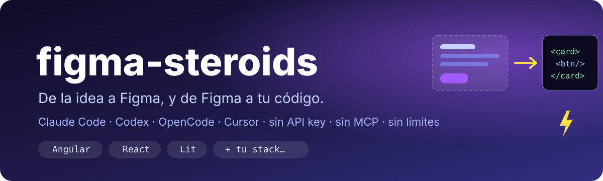

# figma-steroids

<p align="center">
  <a href="README.md">🇪🇸 Español</a> | <a href="README.en.md">🇺🇸 English</a>
</p>

<p align="center">
  
  
  
  
  <a href="LICENSE"></a>
</p>

<p align="center">
  <a href="https://github.com/kennedy122112/figma-steroids/stargazers"></a>
  <a href="https://github.com/kennedy122112/figma-steroids/actions/workflows/validate.yml"></a>
  
  <a href="https://github.com/silships/figma-cli"></a>
</p>

<p align="center">
  
</p>

<p align="center">
  <b>Talk in plain language. Your AI agent designs in your Figma and implements it in your stack.</b><br>
  Local, no API key, no MCP, no usage limits.
</p>

---

## What is it?

**figma-steroids** supercharges [figma-cli](https://github.com/silships/figma-cli) with a set of
**skills** and **agents** that know how to build in Figma Desktop, take care of your design
system, review accessibility, and turn designs into code in **Angular, React, Lit or any other
stack**.

It works with **Claude Code** (as a plugin) and with **Codex, OpenCode, Cursor** or any tool
that supports the Agent Skills standard (through the `figma-steroids init` installer).

Everything runs on your machine: the agent controls Figma through a local plugin (Safe mode),
without patching the Figma app and without sending your design to any cloud service.

> The skills are written in Spanish and include English trigger phrases, so they activate when
> you ask in either language. Your agent answers in the language you use.

## How it works

```
┌───────────────┐   ┌──────────────────┐   ┌───────────┐   ┌──────────────┐   ┌───────────────┐
│  You (chat)   │──►│ Skills & agents  │──►│ figma-cli │──►│ local daemon │──►│ Figma plugin  │
│ build, review │   │  figma-steroids  │   │           │   │    :3456     │   │  (Safe mode)  │
│  implement    │   └────────┬─────────┘   └───────────┘   └──────────────┘   └───────────────┘
└───────────────┘            │
                             ▼
                    ┌──────────────────┐
                    │   Your project   │  Angular · React · Lit · …
                    │  (figma-to-code) │  components, tokens, tests
                    └──────────────────┘
```

## Features

### 🧩 Skills (activate automatically based on what you ask)

| Skill | What it does |
|---|---|
| `figma-setup` | First run: checks Node.js, figma-cli, Figma and the plugin, and installs what's missing (with your permission) |
| `figma-connect` | Connects to Figma Desktop through the plugin (Safe mode) |
| `figma-build-ui` | Builds screens and components with your variables, reusing your components |
| `figma-design-system` | Imports and exports tokens (Tailwind, CSS, DTCG, DESIGN.md); creates a spacing scale, text styles, a `Button` with variants and states, and light / dark mode; detects drift with snapshot/check |
| `figma-a11y-review` | WCAG contrast, touch targets, text size and color-blindness audit |
| `figma-handoff` | Exports PNG/SVG/PDF, tokens, JSX, Storybook stories and specs |
| `figma-to-code` | Implements a frame in your stack and compares it with the design |

### 🤖 Agents (your tool delegates work to them)

In tools without subagents they're installed as roles inside `AGENTS.md`.

| Agent | Role | Edits |
|---|---|---|
| `figma-ui-builder` | Builds UI in Figma and verifies measurements | Yes |
| `figma-design-reviewer` | Reviews hierarchy, consistency, tokens, states and accessibility | No (read-only) |
| `figma-ds-guardian` | Keeps Figma and code from drifting apart | Only with confirmation |

### 🛠️ Stacks supported by `figma-to-code`

| Stack | Adapter | Status |
|---|---|---|
| **Angular + TypeScript + Tailwind** | [`stacks/angular.md`](skills/figma-to-code/stacks/angular.md) | ✅ Tested in a real project |
| **React + TypeScript** (Vite, Next.js…) | [`stacks/react.md`](skills/figma-to-code/stacks/react.md) | ✅ Included · ⏳ not tested yet |
| **Lit** (TypeScript or JavaScript) | [`stacks/lit.md`](skills/figma-to-code/stacks/lit.md) | ✅ Included · ⏳ not tested yet |
| **Anything else** (Vue, Svelte, Flutter, SwiftUI…) | [`stacks/generic.md`](skills/figma-to-code/stacks/generic.md) | ✅ Generic · 🙌 [add yours](#-architecture--contributing) |

**Your project's conventions win**: before writing code, the agent reads your existing
components and follows their style. It reuses your components, maps every Figma variable to an
existing token (or proposes a new one instead of hardcoding hex), and measures the result
against Figma.

### 🌗 Light / dark mode, from Figma to code

Ask *"add a dark mode"* and `figma-design-system`:

1. **Creates the dark theme** with the same variable names: as a `Dark` mode if your Figma plan
   supports modes, or as a parallel `… · Dark` collection on the free plan (which only allows
   one mode per collection).
2. **Previews it** on a copy of your design, next to the original, without touching it.
3. **Checks contrast** for the dark theme.
4. **Brings it to code** as `:root` / `.dark` blocks, ready for Tailwind v4 or plain CSS.

### 🔌 figma-steroids Figma plugin: see what the AI does, and stop it any time

figma-cli's FigCli plugin runs whatever the AI sends without showing anything. The
**figma-steroids** plugin does the same and also shows you what's happening:

| | What you see |
|---|---|
| **Connected file** | Which file and page the AI is working on |
| **Selection with ID** | What you selected, with its ID and a copy button ("review 2:2") |
| **Activity log** | Every AI command: **read** (gray), **+created ~modified −deleted** (blue) or **error** (red, with the failing code) |
| **Show on canvas** | A **Ver** button on each entry that changed something: selects and zooms to what the AI did, even on another page |
| **Saved log** | Kept per file when you close the plugin, up to 100 entries, only on your machine |
| **Copy log** | The whole log as text, to paste back to the AI or attach to a bug report |
| **Pause** | Blocks the AI's commands instantly; the AI gets a clear message that you stopped it |

```bash
npx -y github:kennedy122112/figma-steroids plugin
```

That command copies the plugin to `~/.figma-steroids/figma-plugin` and prints the path of its
`manifest.json`, to import in Figma (**Plugins → Development → Import plugin from manifest…**).
Use it **instead of** FigCli, not alongside it.

Figma doesn't tell your edits apart from the AI's, so the log only counts changes that arrive
in the 3 seconds after each command: if you edit something by hand right then, it may be added
to the AI's entry.

### ⚖️ figma-steroids vs Figma's MCP

| | figma-steroids (figma-cli) | Official Figma MCP |
|---|---|---|
| Connection | Local, plugin in Figma Desktop | Cloud REST API |
| Figma token | Not needed | Required |
| Usage limits | None | Per seat |
| Works offline | Yes | No |
| Closed files or by URL | No, only the open file | Yes |
| Code Connect | No | Yes |

They aren't exclusive: use figma-steroids to build and the MCP to read files you don't have open.

## Where does it work?

figma-cli talks to Figma Desktop **through your own computer**, so the agent has to run on
your machine and be able to run commands. You don't type any: the AI runs them, and the
`figma-setup` skill installs what's missing with your permission.

| App | Works? | Why |
|---|---|---|
| **Claude Desktop, Code tab** | ✅ | It's Claude Code with a UI; the plugin installs the same way |
| **Claude Code** in the terminal or VS Code / JetBrains | ✅ | Runs on your machine |
| **Codex** (terminal or desktop app) | ✅ | Runs on your machine; plugin or installer |
| **Cursor** | ✅ | Its agent runs commands on your machine |
| **OpenCode** | ✅ | Runs on your machine; use the installer |
| **Claude Desktop or claude.ai, regular chat** | ❌ | Chat can't run commands on your computer: use Figma's MCP connector |
| **Cloud versions** (Claude Code on the web, Codex cloud tasks) | ❌ | They run on remote servers that can't see your Figma Desktop |

## Tested with

Real tests against Figma Desktop (Windows 11, figma-cli 2.2.5, Safe mode), October 2026.
Every test found details that are already fixed in the skills.

| Tool | Install | What was tested | Result |
|---|---|---|---|
| **Claude Code** (Claude Desktop, Code tab) | Installer `--ai claude --global` | Skills activating on their own, `figma-setup`, building a card with variables, reviewer subagent, `figma-to-code` in Angular | ✅ |
| **OpenCode** (Desktop) | Installer `--ai opencode --global` | Same, plus a scoped edit of an existing design | ✅ |
| **Codex** (CLI 0.164) | `codex plugin marketplace add` + `codex plugin add` | Installing the plugin from GitHub with its 7 skills | ✅ install · ⏳ not tested in a session |
| **Cursor** | — | `.cursor-plugin/` manifest ready | ⏳ not tested |

Tried it with another tool or stack? Open an issue or a pull request with what you saw.

## Requirements

- [Figma Desktop](https://www.figma.com/downloads/), open.
- [Node.js](https://nodejs.org/) 18.17 or later.
- An AI agent: [Claude Code](https://claude.com/claude-code), Codex, OpenCode, Cursor or another
  tool that supports Agent Skills.

## Installation

### 1. figma-cli

```bash
npm install -g figma-ds-cli
```

If you'd rather not install it, the skills fall back to `npx -p figma-ds-cli figma-cli`.

### 2. Skills and agents

**Claude Code: as a plugin (recommended).** Inside Claude Code:

```
/plugin marketplace add kennedy122112/figma-steroids
/plugin install figma-steroids@figma-steroids
```

**Codex: as a plugin.** In a terminal:

```bash
codex plugin marketplace add kennedy122112/figma-steroids
codex plugin add figma-steroids@figma-steroids
```

The Codex plugin ships the skills; Codex plugins can't include agents. For the agents too, use
the installer with `--ai codex`.

**OpenCode, Cursor, Codex and others: with the installer.** From your project folder:

```bash
npx -y github:kennedy122112/figma-steroids init --ai codex
```

| Option | What it does |
|---|---|
| `--ai codex,cursor` | Several tools at once (`claude`, `codex`, `opencode`, `cursor`, `universal` or `all`) |
| `--global` | Installs in your user folder, for every project |
| `--dry-run` | Shows what it would do without writing anything |
| `--force` | Overwrites your own skills or agents that have the same name |

Other commands: `list` (paths for each tool), `update` (reinstalls the latest version in the
tools already installed), `uninstall` and `plugin` (the Figma plugin). The installer never
touches your own skills or the rest of your `AGENTS.md`: it only manages its
`<!-- figma-steroids -->` block and keeps a record in `.figma-steroids.json`.

| Tool | Skills | Agents | Instructions |
|---|---|---|---|
| **Claude Code** | `.claude/skills/` | `.claude/agents/*.md` | (use the plugin or these folders) |
| **Codex** | `.agents/skills/` | `.codex/agents/*.toml` | `AGENTS.md` |
| **OpenCode** | `.opencode/skills/` | `.opencode/agents/*.md` (subagents) | `AGENTS.md` |
| **Cursor** | `.cursor/skills/` | `.cursor/agents/*.md` | `AGENTS.md` |
| **Universal** | `.agents/skills/` | as roles inside `AGENTS.md` | `AGENTS.md` |

Paths are verified against each tool's official docs and live in
[`platforms.json`](platforms.json).

### 3. The Figma plugin (once)

**Recommended: the figma-steroids plugin** (activity log and pause):

```bash
npx -y github:kennedy122112/figma-steroids plugin
```

Import the `manifest.json` it prints with **Plugins → Development → Import plugin from
manifest…**, then open it with **Plugins → Development → figma-steroids**.

**Or figma-cli's FigCli plugin:** import `figma-ds-cli/plugin/manifest.json` from the folder
`npm root -g` prints, and open **Plugins → Development → FigCli**. Use one of the two, not both.

### Updating

```
/plugin marketplace update figma-steroids
```

With the installer (add `--global` if you installed that way):

```bash
npx -y github:kennedy122112/figma-steroids update
```

## Usage

### First run

With Figma Desktop open, tell your agent:

> "Set up figma-steroids and connect it to my Figma."

### Just ask

```
Connect to Figma and create a pricing card with my variables

Build a login screen with my design system

Review the accessibility of the selected screen

Add a dark mode to my design system

Implement the selected frame in my Angular project
```

### Implementing a design in an existing project

Open your agent in the project, select the frame in Figma and use a prompt like this:

```text
Use figma-to-code to implement the selected frame in this project.
First detect the stack, the component library and where the tokens live.
Reuse existing components and follow the project's conventions.
Map every Figma variable to an existing token; if one is missing, propose it
instead of hardcoding the hex value. Include hover, focus and disabled states
and accessibility attributes. When done, compare against the Figma screenshot
and summarize the changed files and any remaining differences.
```

## 🏗️ Architecture & contributing

```
.claude-plugin/              Claude Code plugin (plugin.json, marketplace.json)
plugin.json                  portable Agent Plugins manifest (Codex, Cursor)
.agents/plugins/             Codex marketplace
.cursor-plugin/              Cursor plugin
skills/<name>/SKILL.md       one folder per skill
skills/figma-to-code/stacks/ one adapter per stack
agents/<name>.md             one file per agent
platforms.json               where to install for each tool (Codex, OpenCode, Cursor…)
lib/installer.mjs            installer and agent-format converters
bin/figma-steroids.mjs       CLI: init, update, uninstall, list, plugin
figma-plugin/                Figma plugin (activity log, pause, selection with ID)
templates/                   templates for new skills and agents
scripts/validate.mjs         validator (also runs in CI)
tests/                       installer tests (Windows, macOS and Linux in CI)
```

Anyone can improve it; skills and agents are Markdown files with instructions:

```bash
# 1. Fork and clone
git clone https://github.com/<your-user>/figma-steroids.git
cd figma-steroids && npm install

# 2. Add or improve something
#    - skill:  copy templates/SKILL.template.md to skills/<name>/SKILL.md
#    - agent:  copy templates/AGENT.template.md to agents/<name>.md
#    - stack:  create skills/figma-to-code/stacks/<stack>.md and link it from the skill
#    - tool:   add an entry to platforms.json (linking its documentation)

# 3. Try it locally with Figma open
claude --plugin-dir .                                         # Claude Code
node bin/figma-steroids.mjs init --ai codex --dry-run         # other tools

# 4. Validate, test and open a pull request
npm run validate && npm test
```

Details in [CONTRIBUTING.md](CONTRIBUTING.md) (Spanish). Changes per version in
[CHANGELOG.md](CHANGELOG.md).

## Troubleshooting

**"Plugin not detected"** — the plugin isn't open in Figma, or it was closed. Open it from
**Plugins → Development** and keep it open while you work.

**The daemon isn't running** — ask your agent to reconnect, or run `figma-cli daemon restart`.

**Commands hit the wrong file** — with several files open, pin the target with part of its
name: `FIGMA_FILE="My file" figma-cli canvas info`.

**"Paused from the figma-steroids plugin"** — you pressed Pause; press Resume in the plugin.

**Skills don't show up in Codex, OpenCode or Cursor** — check where the installer put them with
`npx -y github:kennedy122112/figma-steroids list` and restart the tool.

**"skipped (already exists and isn't from figma-steroids)"** — you have your own skill or agent
with the same name. The installer leaves it alone; use `--force` only to replace it.

---

## Credits

Built on [figma-cli](https://github.com/silships/figma-cli) by Sil Bormüller
([Into Design Systems](https://intodesignsystems.com)), an independent MIT-licensed project.
The Figma plugin in `figma-plugin/` is based on figma-cli's FigCli plugin: it keeps its
protocol with the daemon and adds the interface.

## License

[MIT](LICENSE).
